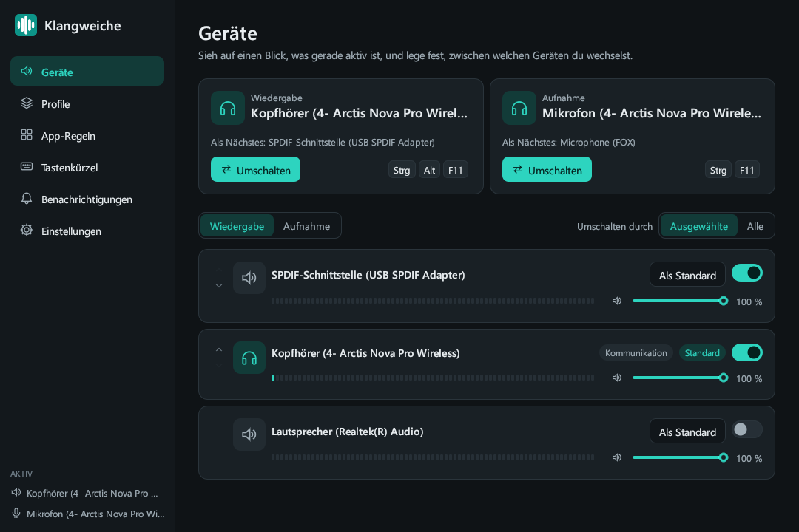
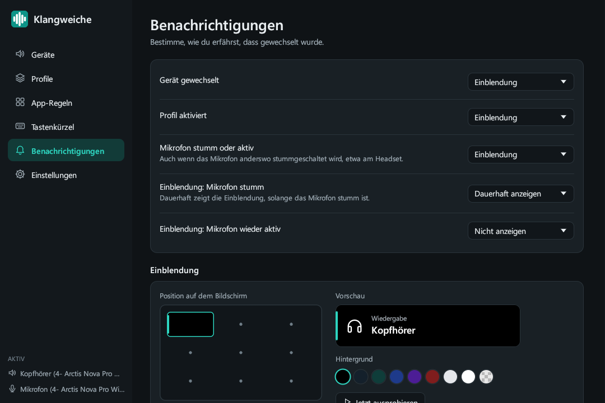
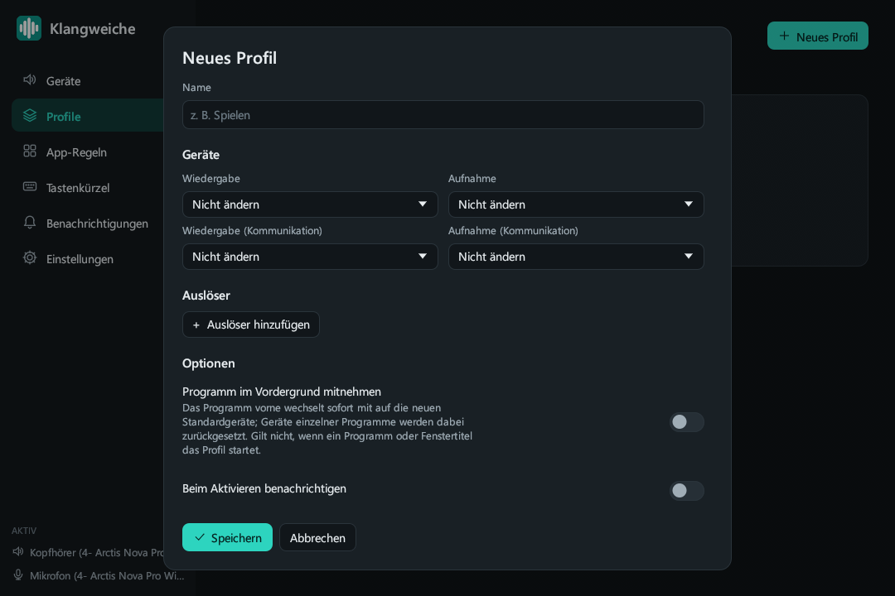

# Klangweiche

**Mit einem Tastendruck zwischen Lautsprecher, Kopfhörer und Mikrofon wechseln.**
Klangweiche sitzt unauffällig im Infobereich und stellt das Standard-Audiogerät um – per Tastenkürzel, per Profil oder automatisch, sobald ein bestimmtes Programm läuft. Für Windows 10/11 und Linux (64 Bit).

[**⬇ Aktuelle Version herunterladen**](../../releases/latest)



## Was Klangweiche kann

- **Umschalten per Tastenkürzel** – ein Druck, und der Ton kommt aus dem nächsten Gerät. Eigene Kürzel für Wiedergabe, Aufnahme und Mikrofon-Stummschaltung.
- **Du bestimmst die Runde** – wähle aus, zwischen welchen Geräten gewechselt wird, und in welcher Reihenfolge.
- **Profile** – mehrere Geräte auf einmal wechseln: per Tastenkürzel, aus dem Menü im Infobereich, beim Start, oder sobald ein Programm oder Fenster nach vorne kommt. Auf Wunsch geht es danach zurück zu den vorherigen Geräten.
- **App-Regeln** – einzelne Programme dauerhaft auf ihr eigenes Gerät legen: Musik auf die Lautsprecher, Anrufe aufs Headset.
- **Einblendungen** – eine kurze Einblendung zeigt, wohin gewechselt wurde. Position, Größe, Farbe und Deckkraft sind einstellbar, bis hin zu voll transparent. Wer mag, bekommt stattdessen einen Ton oder einen Windows-Hinweis.
- **Mikrofon im Blick** – eine dauerhafte Einblendung, solange das Mikrofon stumm ist. Ein Klick darauf schaltet es wieder ein.
- **Lautstärke und Pegel** – alle Geräte mit Lautstärkeregler, Stummschaltung und Live-Pegel in einem Fenster.
- **Kommandozeile** – `klangweiche switch`, `mute`, `profile`, `status` und mehr, für Skripte und Stream-Decks. `klangweiche help` zeigt alle Befehle.
- **Hell und dunkel, Deutsch und Englisch** – richtet sich nach dem System oder nach dir.
- **Hält sich selbst aktuell** – Klangweiche sucht hier nach neuen Versionen und aktualisiert sich auf Knopfdruck. Abschaltbar.

| Benachrichtigungen | Profile |
| --- | --- |
|  |  |

## Installieren

### Windows

| Datei | Wofür |
| --- | --- |
| `Klangweiche-Setup.exe` | Installiert Klangweiche für dich – ohne Administratorrechte. Mit Eintrag im Startmenü und unter *Einstellungen → Apps*, wo es sich auch wieder entfernen lässt. |
| `Klangweiche.exe` | Dasselbe Programm ohne Installation. Einfach starten; nachträglich installieren geht jederzeit unter *Einstellungen → Installation*. |

Windows zeigt beim ersten Start eventuell „Der Computer wurde durch Windows geschützt“, weil das Programm nicht signiert ist. Mit *Weitere Informationen → Trotzdem ausführen* geht es weiter.

### Linux

```sh
tar -xzf Klangweiche-linux-x86_64.tar.gz
cd klangweiche
sh install.sh
```

Danach steht „Klangweiche“ im Anwendungsmenü. Gebraucht werden `pactl` (Paket `pulseaudio-utils`), `notify-send` (`libnotify`) und für Updates `curl`. Das Symbol in der Leiste zeigt KDE direkt an; GNOME braucht die Erweiterung *AppIndicator*.

<details>
<summary>Was unter Linux anders ist</summary>

- Globale Tastenkürzel gibt es unter Wayland nicht. Lege stattdessen in den Systemeinstellungen ein eigenes Tastenkürzel mit einem Befehl an, zum Beispiel `klangweiche switch --type Playback` oder `klangweiche mute --toggle`.
- Profile, die auf das Programm im Vordergrund reagieren, greifen nicht – Linux verrät das anderen Programmen nicht.
- Keine Pegelanzeige; Meldungen kommen als normale Desktop-Benachrichtigung.
- App-Regeln verschieben den Ton von Programmen, die gerade etwas abspielen.

</details>

## Umstieg von SoundSwitch

Klangweiche ist eine eigenständige, neu geschriebene App nach dem Vorbild von [SoundSwitch](https://soundswitch.aaflalo.me/). Findet sie dessen Einstellungen, bietet sie beim ersten Start an, Geräte, Tastenkürzel, Profile und Regeln zu übernehmen.

## Gut zu wissen

- Klangweiche sammelt keine Daten. Die einzige Verbindung ins Internet ist die Suche nach einer neuen Version in diesem Repository.
- Einstellungen liegen unter `%APPDATA%\Klangweiche` (Windows) bzw. `~/.config/klangweiche` (Linux) und bleiben beim Deinstallieren erhalten.

---

**English:** Klangweiche switches your default audio device with a hotkey, a profile, or automatically per program. It lives in the tray, shows a small banner when something changes, has per-app audio rules, a command line, and updates itself from this repository. Download the latest version under [Releases](../../releases/latest): `Klangweiche-Setup.exe` (Windows installer, no admin rights), `Klangweiche.exe` (portable), or `Klangweiche-linux-x86_64.tar.gz` (unpack, then `sh install.sh`). The app speaks English too – it follows your system language.
